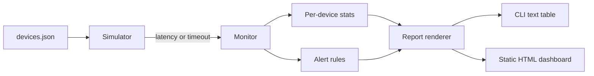

# Network Monitoring Dashboard

A small Python tool that polls **simulated** network devices, tracks up/down state and latency, raises alerts, and renders a static HTML dashboard plus a CLI summary.

> **All data is simulated.** The simulator generates random latencies and failures from a seed. No real devices, networks, or company data are involved, and no network traffic is sent. Real SNMP polling is **not** implemented.

## Problem
Network teams need quick visibility into device health: which devices are up, how slow they are, and when to page someone. This project shows that logic in a minimal, testable form.

## Architecture


- `netmon/simulator.py` – seeded fake devices (base latency, jitter, failure and spike rates)
- `netmon/monitor.py` – polling loop, uptime / avg / p95 / max latency, alert rules
- `netmon/report.py` – text and HTML output (HTML-escaped)
- `netmon/cli.py` – command line entry point

Alert rules: **WARNING** when latency exceeds a threshold; **CRITICAL** after N consecutive failed polls (device marked DOWN); **RECOVERED** when a DOWN device answers again.

## Setup
Requires Python 3.9+ (standard library only). Tests need `pytest`.
```bash
git clone https://github.com/AJJudkins/network-monitoring-dashboard
cd network-monitoring-dashboard
pip install pytest
```

## Usage
```bash
python -m netmon.cli --rounds 60 --alerts --html dashboard.html
python -m netmon.cli --latency-warn 50 --fail-crit 2 --seed 7
python -m pytest
```
Options: `--config`, `--rounds`, `--seed`, `--latency-warn`, `--fail-crit`, `--html`, `--alerts`.

## Sample output
```
DEVICE          ROLE      STATUS     UPTIME%   AVG ms   P95 ms   MAX ms
core-sw-01      core      UP           100.0      1.5      2.2      2.4
edge-rtr-01     router    UP           100.0      8.1     12.0     15.2
access-sw-12    access    UP            90.0      2.6      4.0      4.9
wifi-ap-07      wireless  UP            95.0     30.4    127.7    179.0
branch-vpn-02   vpn       UP           100.0     71.0    316.0    349.1

60 polls/device | alerts: 0 critical, 12 warning
```
A sample generated report is in `examples/sample_dashboard.html`.

## What it demonstrates
- Monitoring and alerting concepts (uptime, latency percentiles, thresholds, state transitions)
- Clean Python structure, a CLI, and reproducible simulation for testing
- Unit tests for alert logic, recovery, reproducibility, HTML escaping, and CLI errors

## Limitations
Simulated only; no SNMP/ICMP; no persistence or live refresh.

## License
MIT
