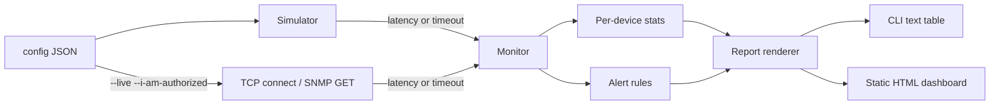

# Network Monitoring Dashboard

[](https://github.com/AJJudkins/network-monitoring-dashboard/actions/workflows/ci.yml)

A small Python tool that tracks up/down state and latency for network devices, raises alerts, and renders a static HTML dashboard plus a CLI summary. It runs against **simulated** devices by default and, with an explicit flag, against **real targets using read-only checks** (TCP connect, optional SNMP GET).

> **Default mode is simulated:** random latencies and failures from a seed, no network traffic. **`--live` mode** sends only TCP connects and SNMP GETs to targets you list, requires `--i-am-authorized`, and never writes to or reconfigures a device. Only monitor systems you own or have written permission to monitor.

## Problem
Network teams need quick visibility into device health: which devices are up, how slow they are, and when to page someone. This project shows that logic in a minimal, testable form.

## Architecture


- `netmon/simulator.py` – seeded fake devices (base latency, jitter, failure and spike rates)
- `netmon/live.py` – read-only live checks: TCP connect and SNMP v2c/v3 GET (via net-snmp's `snmpget`), config validation, per-target timeout and rate limit
- `netmon/monitor.py` – polling loop, uptime / avg / p95 / max latency, alert rules
- `netmon/report.py` – text and HTML output (HTML-escaped)
- `netmon/cli.py` – command line entry point

Alert rules: **WARNING** when latency exceeds a threshold; **CRITICAL** after N consecutive failed polls (device marked DOWN); **RECOVERED** when a DOWN device answers again.

## Setup
Requires Python 3.9+ (standard library only). Live SNMP is optional and needs net-snmp's `snmpget` installed (`apt install snmp`). Tests need `pytest`.
```bash
git clone https://github.com/AJJudkins/network-monitoring-dashboard
cd network-monitoring-dashboard
pip install pytest
```

## Usage
```bash
python -m netmon.cli --rounds 60 --alerts --html dashboard.html
python -m netmon.cli --latency-warn 50 --fail-crit 2 --seed 7
python -m pytest
```
Options: `--config`, `--rounds`, `--seed`, `--latency-warn`, `--fail-crit`, `--html`, `--alerts`, `--live`, `--i-am-authorized`, `--interval`.

### Live, read-only monitoring
Copy `examples/live-targets.example.json`, put in **your own** hosts (the example uses `127.0.0.1` and a documentation-range address), then:
```bash
python -m netmon.cli --config my-targets.json --live --i-am-authorized --rounds 5 --interval 2 --alerts
# SNMP credentials come from environment variables, never from the config file:
export NETMON_SNMP_COMMUNITY='...'                       # v2c
export NETMON_SNMP_USER=... NETMON_SNMP_AUTH_PASS=... NETMON_SNMP_PRIV_PASS=...   # v3 (authPriv)
```
- **TCP target:** opens a connection to `host:port` and closes it immediately (no data sent); latency is the connect time. No ICMP is used.
- **SNMP target (optional):** one `snmpget` of `sysUpTime.0` (`1.3.6.1.2.1.1.3.0`, or another numeric OID you set) with `-r 0` and a hard timeout. Only GET is ever issued (no SET, no walk).
- **Limits:** at most 50 targets; timeout 0-30 s per target; at least 1 s between polls of the same target (`--interval` can only raise this); hosts and OIDs are validated and passed to `snmpget` as an argument list (no shell).
- The simulator file format (a JSON list) still works for default mode; a live config is an object with a `targets` list (and may also hold a `simulated` list).

## Sample output
```
DEVICE          ROLE      STATUS     UPTIME%   AVG ms   P95 ms   MAX ms
core-sw-01      core      UP           100.0      1.5      2.2      2.4
edge-rtr-01     router    UP           100.0      8.1     12.0     15.2
access-sw-12    access    UP            90.0      2.6      4.0      4.9
wifi-ap-07      wireless  UP            95.0     30.4    127.7    179.0
branch-vpn-02   vpn       UP           100.0     71.0    316.0    349.1

60 polls/device | alerts: 0 critical, 12 warning
```
A sample generated report is in `examples/sample_dashboard.html`.

## What it demonstrates
- Monitoring and alerting concepts (uptime, latency percentiles, thresholds, state transitions)
- Clean Python structure, a CLI, and reproducible simulation for testing
- Unit tests for alert logic, recovery, reproducibility, HTML escaping, and CLI errors

## Limitations
No ICMP ping, no SNMP traps/walks/SET, no persistence, no live-refresh dashboard. SNMP uses the external `snmpget` binary rather than a Python library.

## Security and testing status

- **Safety:** default mode is simulated and sends no traffic. `--live` is opt-in, needs `--i-am-authorized`, issues only TCP connects and SNMP GETs (no SET/walk/ICMP), has timeouts, a minimum 1 s per-target interval and a 50-target cap, and takes SNMP credentials from environment variables only.
- **Tested:** simulator and alert logic; live config validation; TCP checks against local listeners on 127.0.0.1; SNMP command construction and polling against a mocked `snmpget` runner; CLI authorization gate.
- **Not tested:** live polling of any real network device; real `snmpget`/SNMPv2c/v3 exchanges (the SNMP path has only been exercised with a mocked runner); behavior with firewalls, rate-limiting devices or IPv6-only targets.
- See [SECURITY.md](SECURITY.md).

## License
MIT
